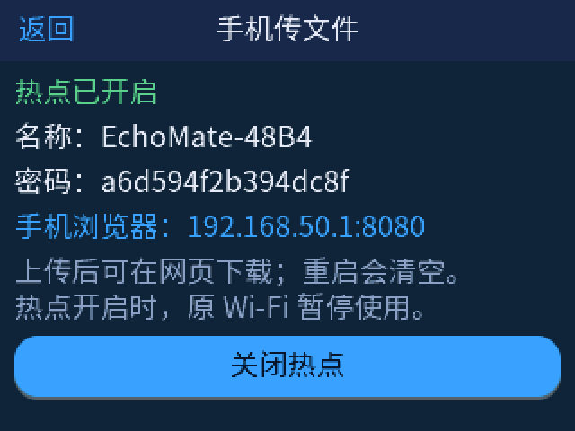

# LVGL 手机热点入口

## 工作事项

- 在主页增加「手机传文件」入口，并在「网络连接」页增加同名按钮。
- 新建 320×240 的热点管理页，显示运行状态、SSID、密码、手机浏览器地址及开启/关闭按钮。
- 热点开启时网络页停止扫描，避免 `iw scan` 与 AP 模式争用同一块无线网卡。
- 将热点脚本的启动/停止放到后台线程，LVGL 线程只读取状态快照并更新控件。

## 架构与实现原理

`src/ui/ui_hotspot.c` 只负责展示和按钮事件；`src/wifi/hotspot_control.cpp` 负责读 PID 文件、密码文件和执行固定路径的 `/root/bin/echomate-hotspot.sh`。UI 每 500 ms 轮询一次状态，文本无变化时不调用 `lv_label_set_text()`，避免在 SPI 小屏上反复重绘。按钮执行期间置为禁用，完成后恢复。

后台线程调用脚本，因此关闭现有 Wi-Fi、启动 `hostapd` 和 DHCP 的数秒过程不会卡住触摸主循环。状态检查要求 `hostapd`、`dnsmasq` 和传输服务三个 PID 都存活；密码只在热点运行时显示。`网络连接`页在热点运行期间显示「手机热点已开启」，不再发起扫描或切换普通 Wi-Fi。

入口使用原有 `ui_nav_push()` 导航；调试可用 `LVGL_START_PAGE=hotspot` 直接打开。热点脚本与传输服务由上一功能部署在 `/root/bin/`，不随 LVGL 程序重启。

## 板上验证

- 交叉编译通过。限时以 `LVGL_START_PAGE=hotspot` 运行，页面尺寸 320×240、退出码 0。
- 抓取板上屏幕，确认状态、SSID、密码、地址和按钮全部可见；首次抓屏发现默认字体颜色过暗，已设为主题浅色并再次抓屏核对。
- 用与 UI 按钮相同的 C++ 控制接口实测：初始运行中 → 关闭后运行状态 0、错误 0 → 重新开启后状态 1、错误 0。
- 测试后恢复 LVGL 守护进程，热点和手机文件服务继续运行。

## 注意事项与后续工作

- 热点开启时家庭 Wi-Fi 会断开，天气、语音云服务可能暂时不可用；关闭热点后脚本会尝试恢复原 Wi-Fi。
- 开关只管理当前运行状态，不做开机自动启动。密码由热点脚本保存在板上 `/root/.echomate-hotspot-password`，不会写进仓库。
- 若板上缺少 `hostapd`、`dnsmasq` 或传输服务，页面会显示启动失败；构建与安装方式见《开发板热点与手机文件传输》。
- 后续可在屏幕上加二维码以减少手机输入密码的步骤，但当前字体和屏幕布局已经可以直接读出密码与地址。
